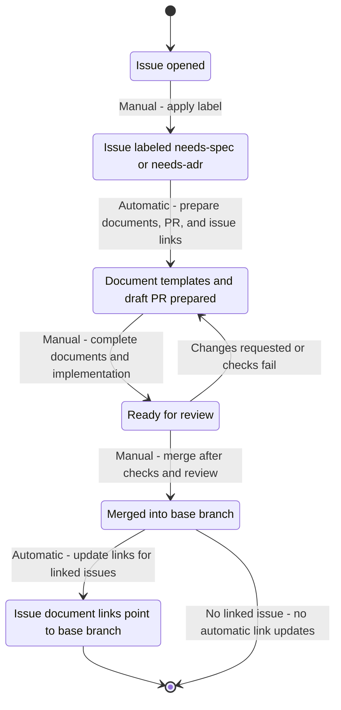

# Development process

Development connects a reported problem to specified behavior, implementation, verification, and release. Issues describe the problem, feature specifications define observable behavior, and Architecture Decision Records (ADRs) explain significant design choices. A pull request brings the code, tests, and documentation together for review.

This process applies to repositories using the SDLC action. Labels and document directories below use the action's defaults; repositories can configure them through the [action inputs](../README.md#inputs). Small fixes and documentation corrections can go directly to a pull request when a separate specification or ADR would add little value.

## Process overview

The automation prepares document templates, a working branch, and a draft PR. Contributors complete the documents, implement the change, verify it, and review it. GitHub automatically associates a PR created from an issue-linked branch, allowing issue closure on merge without an explicit closing keyword in the description.



The base branch defaults to the consuming repository's default branch. The repository installs the [caller workflows](../examples/) to enable the automatic steps; see [adoption instructions](../README.md#adoption).

## 1. Describe the problem in an issue

Search existing issues first. Describe current behavior, the desired outcome, and the scope of the change. Bug reports should include a minimal reproduction, expected and actual behavior, and relevant environment details. Discuss substantial changes before implementation.

Keep the issue as the entry point for the work. The automation adds document links to its body, giving reviewers access to the requirements and design rationale alongside the code.

## 2. Specify behavior and record design decisions

Apply `needs-spec` for a feature specification, `needs-adr` for an architecture decision, or both. The action reuses the branch linked in the issue's **Development** section, regardless of its name. If none is linked, it creates `<issue-number>-<title-slug>`. Both labels share the branch and PR.

New draft PRs use `feat: <issue title>` and a description containing a related issue link and a TODO. Complete that description as the change develops. Existing PR titles and document content are preserved on reruns.

Complete the [specification template](../scripts/templates/spec.md) before implementing behavior changes. Define:

- Scope and explicit exclusions.
- Observable, testable requirements, including defaults and diagnostics where relevant.
- Acceptance scenarios covering success, failure, and boundary cases.
- Verification guidance and links to the tests that exercise those scenarios.

Use the [ADR template](../scripts/templates/adr.md) for significant architectural choices. Describe the context, alternatives, decision, and consequences. ADRs begin as `Proposed`; update the status when the decision is agreed. Link the ADR and specification to each other when they concern the same change.

Specifications default to `doc/specs/<title-slug>.md`; ADRs default to `doc/adrs/<sequential-number>-<title-slug>.md`. Keep the issue association in YAML front matter:

```yaml
---
issue: 70
---
```

Preserve this metadata when editing or renaming documents so reruns can find them. Update the specification as behavior evolves. If the second label creates a related document later, add the reverse link manually; the action preserves the existing document.

## 3. Implement and verify the change

Work on the issue's branch. Derive tests from the acceptance scenarios, and include a regression test for a bug fix. Keep unit tests independent of live services by mocking external dependencies where appropriate.

Run focused tests during development, then the consuming repository's required checks before requesting review. Record manual verification and any checks that could not be run. Update user documentation and examples when interfaces or behavior change.

The action prepares the work; each repository defines its own build, test, formatting, and release commands.

## 4. Review in a pull request

Keep the PR focused on one change. Describe the resulting behavior and verification, and link the specification and ADRs so reviewers can compare the implementation with its requirements and understand the design.

Check the issue association in **Development**. PRs created from issue-linked branches are associated automatically; `Related issue: #70` is sufficient descriptive text for this flow. If the association is missing, link the issue through **Development** or a closing reference.

Review requirements, code, tests, and documentation together. Resolve failed checks and review feedback, then mark the draft ready for review. Merging remains a contributor action.

## 5. Merge and keep issue links useful

When the PR merges into the configured base branch, GitHub can close its associated issue. The `sync-links` operation promotes matching specification and ADR links in linked issue bodies from the working branch to the base branch. It uses GitHub's issue associations, including automatic branch associations, rather than searching the PR text for closing keywords.

Keep document paths consistent through the merge. Renamed paths and issue comments are not updated automatically. If a documentation-only merge should leave the implementation issue open, remove its closing association before merging and update its document links manually.

## 6. Release according to the repository's policy

Merging and releasing are separate steps. Follow the consuming repository's versioning and release process when a release is needed. The SDLC action does not publish packages, deploy software, approve PRs, or merge them.

## Developing this action

Implementation lives in [`scripts/`](../scripts/), action metadata in [`action.yml`](../action.yml), and regression tests in [`tests/`](../tests/). Update the relevant tests when changing API requests, document generation, configuration, outputs, or branch and PR reuse.

From the action repository root, run:

```bash
python3 -m unittest discover -s tests -p 'test_*.py'
```

The [action CI workflow](../.github/workflows/test.yml) tests supported Python versions and runs a composite-action smoke check. Use a disposable consuming repository to verify actual label events, generated documents and PRs, reruns, and merge link updates before a release. Unit tests use mocked GitHub API responses.

Update [usage documentation](../README.md) and [caller workflow examples](../examples/) when inputs, outputs, or behavior change. Follow the [release preparation instructions](../README.md#tests-and-release-preparation) to publish a versioned action that consumers can adopt deliberately.
